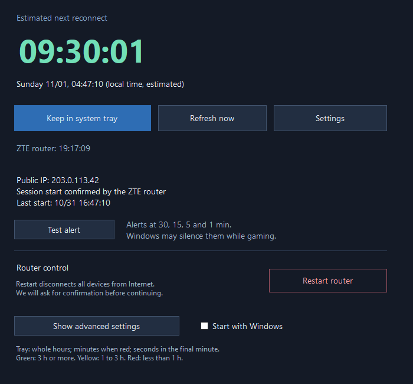
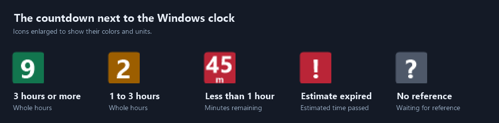

# Dynamic IP Monitor

[Español](README.md) · [English](README.en.md)

A Windows countdown that warns you before a possible Internet reconnection.
Useful before starting a race or an online match.



*Application preview with example data.*



*Icons enlarged to show the colors and units displayed next to the Windows clock.*

**Version 0.5.1-beta.** Direct session reading has been tested with an **Antel ZTE
F6600**. Other models or firmware may need a different adapter. Public IP monitoring
works with other routers, with less accurate timing. This is an independent
project, not affiliated with Antel or ZTE.

## Download and start

1. Open this repository's **Releases** and download `DynamicIPMonitor-0.5.1-beta-windows.zip`.
2. Extract the ZIP and run `DynamicIPMonitor.exe`.
3. Choose **Settings → Language**: Español, English, or Automatic (Windows).
4. Allow router reading if you have a compatible F6600. Check its local URL;
   the suggested address is `http://192.168.1.1/`.
5. Optional credentials override values prefilled by the router's own login page.
   Leaving them blank works only if the router provides prefilled values.
6. Open **Show advanced settings** to adjust the cycle, then test notifications.

Requires Windows 10 or 11 and .NET Framework 4.8. No Python, SDK or administrator
rights are needed to run it. There is no Linux or macOS version. The beta executable
is not code-signed; Windows may show an unknown-publisher warning.

The automatic language setting selects Spanish for Spanish Windows installations
and English otherwise. Changing language takes effect immediately and is saved
locally. The interface, tray menu, notifications and displayed dates are translated.

Closing the window keeps monitoring in the system tray. Right-click its icon and
choose **Exit and stop monitoring** to quit. **Start with Windows** enables startup
for your user account. Disable and re-enable it if you move the executable.

## Countdown and colors

The tray icon shows a single large number: whole hours when at least one hour
remains, minutes below one hour, and seconds during the final minute. Green means
3 hours or more; amber means 1 to 3 hours; red means less than 1 hour. Hover over the
icon for the full countdown. A gray `?` means no reference; a red `!` means the
estimated time has passed. Drag the icon out of Windows' hidden-icons menu if you
want it to stay visible.

With router reading enabled, the app checks the connected public IPv4 PPPoE session
every 30 seconds. It subtracts the router's IPv4 online duration from the reading
time to calculate session start. It ignores the private management connection.
This can recover the current session start after the PC has been off, and detect
a new session with the same IP. Session-start shifts of up to 90 seconds are
tolerated to avoid false resets from reading differences.

**Session start comes from the router; the next interruption is an estimate.**
The default 12-hour cycle is configurable and is not a provider guarantee. A new
session does not prove the public IP changed at that exact time. Timing depends
on the router counter and Windows clock.

If router reading is disabled or unavailable, the app checks public IP over HTTPS
and confirms changes with another provider. Initially, enter a manual reference
or wait for an observed IP change. Public IP alone cannot detect a reconnection
that keeps the same IP. VPNs and network changes can affect the observed IP. Timing
is uncertain after monitoring gaps.

Alerts occur at 30, 15, 5 and 1 minute, when the estimate expires, and when changes
are detected. An expired countdown waits for a new reference instead of silently
adding another cycle. The app must be running and the PC on to notify you.
Windows may silence alerts while gaming or in Do not disturb.

## Privacy and local data

Data lives in `%LOCALAPPDATA%\DynamicIPMonitor`; **Open my data** opens this folder.
It contains `config.json`, `estado.json`, their backups, `historial.csv`, and
`sesiones-router.csv`. These filenames remain stable across languages.

An optional saved password is protected with Windows DPAPI for the current user;
it is not portable to another Windows account. Authentication cookies stay in
memory. Monitoring reads status automatically. **Restart router** sends a reboot
only after confirmation; Internet disconnects for all devices for several minutes.
It does not restore factory settings. The default local router URL uses HTTP.

Fallback services are `api.ipify.org`, `checkip.amazonaws.com`, and
`ipv4.icanhazip.com`. They receive your public IP, not router credentials or history.
There is no telemetry or automatic updater. Do not publish local settings,
histories, cookies, or raw router responses in issues or distributions.

## Build and test

From the repository root in PowerShell:

```powershell
.\scripts\build.ps1
.\scripts\test.ps1
.\scripts\package.ps1
```

Uses the Windows .NET Framework compiler with no NuGet downloads. The executable
is written to `bin/` and the release ZIP to `dist/`. Tests use isolated `test-data/`
and do not access routers or external IP services. Tests compile to a separate
`bin/RegressionTests.exe`; test and diagnostic code is not shipped in the app.
Packaging uses an explicit allowlist to exclude runtime data and test tools.

GitHub Actions builds, tests, and packages the app. A matching version tag creates
a public prerelease with the ZIP and SHA-256 checksum after the build and tests pass.

Translations live in `src/I18n.cs`. Keep both language entries for every new UI
message and use `L.T` for displayed text. Raw CSV columns and technical test logs
remain stable across language changes. Operating system error details may use the
Windows system language.

Licensed under [MIT](LICENSE).

## Main actions

Below the countdown, use **Keep in system tray**, **Refresh now**, or **Settings**.
**Refresh now** reads the connection without waiting for the next automatic poll.
Manual reference, cycle length, and local files are under
**Show advanced settings**. Router restart has a separate section with a warning.
The **Start with Windows** checkbox is always visible in the main window.
When enabled, the app opens in the system tray when you sign in to Windows.

## Restarting the router

Enable ZTE router reading to use **Restart router**. Confirmation is required every
time. The countdown adjusts from the next router reading, not the button click.
If the response is lost, the result stays unconfirmed and the restart is not retried.
Request preparation was checked on the F6600; an actual reboot was not run as a test.
