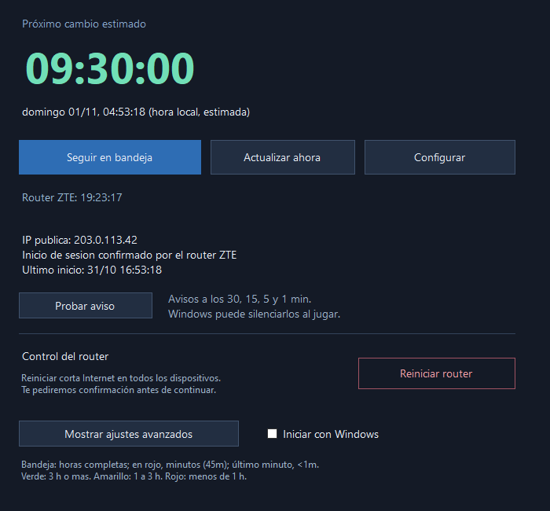

# Dynamic IP Monitor

[Español](README.md) · [English](README.en.md)

Contador para Windows que avisa antes de una posible reconexión de Internet.
Pensado para evitar empezar una carrera o partida cerca del cambio de sesión.



*Vista de la aplicación con datos de ejemplo.*


*Íconos ampliados para mostrar los colores y las unidades que aparecen junto al reloj de Windows.*

**Versión 0.5.2-beta.** La lectura del router se probó con un **ZTE F6600 de Antel**.
Otros modelos o versiones del firmware pueden requerir otro adaptador. El modo
de IP pública permite usar el monitor con otros routers, con menor precisión.
Proyecto independiente, sin afiliación con Antel ni ZTE.

**Idiomas:** español e inglés. Elegí **Configurar → Idioma** para cambiar entre
Español, English y Automático (Windows), sin reiniciar. El modo automático usa
español para Windows en español e inglés para los demás idiomas. La preferencia
se guarda localmente. Incluye interfaz, menús de bandeja, avisos y fechas.

## Descargar y usar

1. Abrí **Releases** en este repositorio y descargá `DynamicIPMonitor-0.5.2-beta-windows.zip`.
2. Extraé el ZIP en una carpeta y ejecutá `DynamicIPMonitor.exe`.
3. En la primera apertura elegí si autorizás la lectura de tu router o preferís solo IP pública.
4. Si usás un F6600 compatible, revisá su dirección. El valor sugerido es `http://192.168.1.1/`.
5. Dejá las credenciales vacías para usar los valores que el propio panel traiga
   precargados, si existen; si cambiaste las credenciales, podés ingresar las tuyas.
6. En **Mostrar ajustes avanzados**, ajustá el ciclo si no usa 12 horas. Probá los avisos.

Requiere **Windows 10 u 11 y .NET Framework 4.8**. No requiere Python, SDK ni
permisos de administrador para ejecutarse. No hay versión para Linux o macOS.
El ejecutable de esta beta no tiene firma de código; Windows puede mostrar una
advertencia de editor desconocido. El código fuente y el proceso de compilación
están disponibles para revisarlos.

El ícono junto al reloj muestra **horas completas** mientras falte una hora o más,
y **minutos en una sola línea** cuando está en rojo: `45m`. Durante el último minuto
muestra `<1m`, sin cambiar a segundos. Por ejemplo, 11 h 37 min se muestra como `11`. Cambia a **verde con 3 h o más**, **amarillo entre 1 y 3 h**
y **rojo con menos de 1 h**. Al pasar el mouse muestra el tiempo completo, incluidos
los segundos. Un `?` gris significa que falta una referencia y un `!` rojo indica
que la hora estimada ya pasó. Si Windows lo oculta, arrastralo desde el menú de
íconos ocultos hacia la bandeja para dejarlo siempre a la vista.

Debajo del contador tenés **Seguir en bandeja**, **Actualizar ahora** y **Configurar**.
**Actualizar ahora** consulta el estado sin esperar la próxima lectura automática.
La referencia manual, el ciclo y los archivos locales están
en **Mostrar ajustes avanzados**. El reinicio del router tiene un bloque separado.

Cerrar con la X mantiene el monitor en la bandeja junto al reloj. Para detenerlo:
clic derecho en el ícono → **Salir y detener monitoreo**.
La casilla **Iniciar con Windows**, visible en la ventana principal, configura el inicio
para tu usuario. Al iniciar sesión en Windows, el monitor se abre en la bandeja junto al reloj.
Si movés el ejecutable, desmarcá y volvé a marcar esa casilla.

El botón **Reiniciar router** está disponible con la lectura del ZTE habilitada.
Pide confirmación cada vez. Luego espera una nueva lectura del router para ajustar
el contador; no toma la hora del clic como inicio de la sesión. Si se pierde la
respuesta, muestra el resultado como no confirmado y no repite el reinicio.
La preparación se verificó con el F6600; el reinicio real no se ejecutó como prueba.

## Qué mide

En modo router, consulta cada 30 segundos la **Duración en línea IPv4** de la
sesión PPPoE conectada con IP pública. Calcula su inicio restando esa duración
a la hora de la lectura. Descarta la conexión de gestión con dirección privada.
Puede recuperar el inicio de la sesión actual después de apagar la PC y detectar
una sesión nueva con la misma IP. Usa una tolerancia de 90 segundos para cambios
del inicio calculado, para evitar reinicios por pequeñas diferencias de lectura.

**El inicio de sesión proviene del contador del router; el próximo corte es una
estimación.** Las 12 horas son un valor inicial configurable, no una garantía del
proveedor. El inicio de una sesión tampoco demuestra que la IP haya cambiado en
ese instante. Los cálculos dependen del contador del router y del reloj de Windows.

Si el router no está habilitado o no se puede leer, consulta la IP pública mediante
HTTPS y confirma cambios con una segunda fuente. En este modo hace falta una
referencia manual inicial o esperar un cambio observado. Una reconexión con la
misma IP no se detecta mediante la IP pública. Una VPN o cambiar de red también
pueden cambiar la IP observada. Después de una pausa, la hora puede ser incierta.

Avisos: **30, 15, 5 y 1 minuto**, al llegar a la hora estimada y al detectar un
cambio. El contador vencido espera una nueva referencia; no suma automáticamente
otras 12 horas. Windows puede silenciar avisos al jugar o con No molestar.
El programa debe estar funcionando y la PC encendida para avisar.

## Datos y privacidad

Los datos de cada persona se guardan en `%LOCALAPPDATA%\DynamicIPMonitor`:

| Archivo | Contenido |
| --- | --- |
| `config.json` y `.bak` | Dirección y preferencias, usuario y contraseña opcional protegida con Windows DPAPI para el usuario actual |
| `estado.json` | IP, referencia del contador y última lectura |
| `estado.json.bak` | Respaldo del estado anterior |
| `historial.csv` | Cambios observados entre lecturas |
| `sesiones-router.csv` | Inicios calculados desde el router |

El botón **Abrir mis datos** abre esa carpeta. No compartas esos archivos como
parte del proyecto ni los adjuntes a un reporte sin revisarlos: contienen datos
de tu red. La contraseña protegida no es portable a otra cuenta de Windows.
Las cookies de autenticación se conservan únicamente en memoria. El programa
consulta el estado automáticamente. **Reiniciar router** envía un reinicio solo
después de tu confirmación; corta Internet para todos los dispositivos durante
varios minutos. No restablece valores de fábrica. El protocolo
local depende del equipo; la dirección predeterminada usa HTTP.

Los servicios externos del respaldo son `api.ipify.org`, `checkip.amazonaws.com`
y `ipv4.icanhazip.com`; reciben tu IP como cualquier servicio al que te conectás.
No se les envían credenciales ni historiales. El proyecto no incorpora telemetría
ni actualizaciones automáticas.

## Compilar y probar

En PowerShell, desde la raíz del repositorio:

```powershell
.\scripts\build.ps1
.\scripts\test.ps1
.\scripts\package.ps1
```

Usa el compilador de .NET Framework de Windows, sin dependencias NuGet ni descargas
durante la compilación. El resultado es `bin\DynamicIPMonitor.exe` y el ZIP se genera en
`dist\`. Las pruebas usan datos aislados en `test-data\` y no acceden al router ni
consultan servicios externos. Se compilan en `bin\RegressionTests.exe`, separado
del programa distribuido. El empaquetado usa una lista explícita de archivos para
que los datos locales y las herramientas de prueba no terminen en una distribución.

GitHub Actions compila, prueba y adjunta el paquete a cada ejecución. Al subir una
etiqueta que coincida con la versión del ejecutable, publica una **beta en Releases** con el ZIP y su SHA-256,
únicamente después de que la compilación y las pruebas terminen correctamente.

## Contribuir

Para proponer soporte para otro router, abrí un issue indicando modelo, firmware y
si ofrece duración de la sesión WAN. No publiques contraseñas, cookies, tokens,
números de serie ni respuestas completas de los paneles. Los parsers pueden
probarse con muestras sintéticas sin datos de conexiones reales.

Licencia [MIT](LICENSE).
